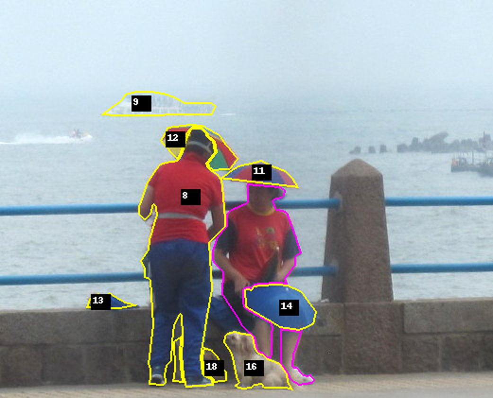

# ANCHOR: relation–set consistency in rule-based grounding

**Ask twice, get two answers.** Ask a vision–language model (VLM) for *"every object bordering her, except the bigger ones"* and you get one set of objects. Ask it, object by object, whether each borders her and whether it is bigger, then run the rule on its answers, and you get a different set. ANCHOR is a testbed that measures how far apart those two answers are, with computed ground truth for both.

> Status: work in progress, aiming at IEEE MultiMedia. Results cover four open instruct VLMs and one thinking model. Proprietary models and the SAM 3 Agent baseline are still to come. Every number below is measured, with 95% CIs from an image-clustered bootstrap; see [data/eval/results/](data/eval/results/).

<p align="center"></p>

*Running example (fixed before any model was run). Subject: the seated woman (magenta outline). Rule: "bordering her, except larger". Ground truth {#11 umbrella hat, #14 umbrella, #16 dog}. Qwen3-VL-4B's set answer is {#8, #12, #16} (F1 0.33). Its own relation answers, run through the rule, give {#11, #12, #14, #16, #18} (F1 0.75). It judges correctly that the man (#8) borders her and is larger, yet keeps him in the set.*

## Context

This project rebuilds our earlier **SADL** benchmark (Subject-Aware Distractor Localization, [arXiv 2606.30393](https://arxiv.org/abs/2606.30393)). SADL asked models which objects "distract" from a subject. Reviewers rejected it for its small size, its judgement-based labels (κ = 0.53) and the lack of a clear insight. We keep only its one robust observation, that VLMs do not follow the rule written in the prompt, and drop the attention taxonomy entirely:
- **No human-attention claims.** We measure only whether a model's answers agree with a rule program, and with each other.
- **Rules are programs.** Every answer set is computed from human-verified panoptic masks (COCONut-PanCap). Objects inside a numeric margin are not scored.
- **No segmenter in the score.** Models answer with mark numbers over ground-truth segments.

## Research position

**Task: rule-based set grounding.** The input is an image with numbered objects, a subject and a rule that states its own definitions. The output is every object for which the rule holds. The rules combine six measurable relations with AND, NOT, EXCEPT and a closure:
- the relations are *borders* (outlines meet in the image), *larger/smaller* (pixel ratio > 1.5), *left of*, *above*, *same kind*, and *reaches the image edge*;
- there are 16 templates at three levels: L1 uses one relation, L2 two, L3 a nested exception or a closure.

**Measurement.** Every model is asked the same question two ways:
- the **set answer** is one call that returns the list of objects;
- the **relation answers** are yes/no judgements of every relation for every object, which we run through the same rule program (the **executed set**).

Because every answer has ground truth, we report two measures:
- **agreement**: the share of objects on which the two answers make the same decision, against the agreement that independent errors would give;
- **error coupling φ**: whether the two answers make the *same* mistakes.

Two reference pairs show how much disagreement re-asking alone produces: the same relation call drawn twice, and the same rule worded two ways.

**How it differs from prior work** (details in [lit-review/](lit-review/)):

| Line of work | What it has | What ANCHOR adds |
|---|---|---|
| Mask-derived spatial QA (Rädsch 2025, CV-Bench, SpatialRGPT) | Programmatic answers about one object or pair | Set answers anchored to a subject and composed by rules; the pairwise answer becomes one of two answers being compared |
| Generalized referring (gRefCOCO/GREx), SAM 3 | Multi-target sets | Executable rules instead of free text; relations and exceptions that concept search does not cover |
| Consistency studies (SQuINT, GV-consistency, ConBench) | Agreement between answers | Ground truth for every sub-answer, so shared errors can be told apart from chance agreement |
| Rule following and negation (VLM-Fix, NegBench, Tumu 2025) | Rule drift and ignored "not" | Exceptions over object sets in natural images, with the error direction measured |

## Results so far

**Testbed.** The Test set has 7,000 items on 3,120 subjects in 2,568 COCO images (L1 1,500 · L2 4,500 · L3 1,000). About 15% of L2/L3 items have the empty set as their answer. **Lite** is a subset of 1,497 items, drawn as whole subjects.

**1. The set answer barely follows from the model's own relation answers.** Lite, L2/L3 rules. Each cell gives agreement · φ.

| Model | Same relation call, 2 draws | Rule reworded | **Set vs. own relations** | If errors were independent | Δφ reworded − set (95% CI) |
|---|---|---|---|---|---|
| Qwen3-VL-4B | 0.92 · 0.81 | 0.81 · 0.57 | **0.58 · 0.09** | 0.54 | 0.48 (0.37, 0.59) |
| Qwen3-VL-8B | 0.91 · 0.78 | 0.83 · 0.59 | **0.69 · 0.30** | 0.56 | 0.29 (0.18, 0.39) |
| InternVL3-8B | 0.85 · 0.66 | 0.79 · 0.54 | **0.59 · 0.11** | 0.54 | 0.42 (0.33, 0.51) |
| Gemma-3-4B | 0.92 · 0.83 | 0.69 · 0.37 | **0.53 · 0.06** | 0.50 | 0.31 (0.22, 0.40) |
| Qwen3-VL-8B-Thinking | — | 0.83 · 0.50 | **0.77 · 0.38** | 0.63 | 0.13 (0.05, 0.21) |

The mismatch is already present for single-relation (L1) rules in four of five models, so it is not a failure to combine relations.

**2. Models adopt our definitions but under-apply exceptions.**
- Told that "borders" includes objects that only overlap the subject in the picture, models include 27–37 points more such objects than when asked about physical touching (12 points for Gemma).
- Where a NOT or EXCEPT clause removes an object, the instruct models still keep it 52–69% of the time. They wrongly drop only 24–39% of the objects the rule keeps.
- With thinking, Qwen3-VL-8B keeps 17% of the objects an AND-NOT clause removes (53% without thinking), and 25% under EXCEPT (57% without). Its two answers become coupled in exactly those cells: Δφ +0.42 for AND-NOT and +0.26 for EXCEPT.

**3. Neither route gives reliable sets.** Test, set F1. The pre-registered hypothesis was that running the model's relation answers through the rule beats its set answer. For the instruct models it did the reverse.

| | Set answer F1 L1 / L2 / L3 | Executed set F1, L2/L3 | ΔG (95% CI) |
|---|---|---|---|
| Answer `[]` · random at prior | 0.36 / 0.15 / 0.15 · 0.24 / 0.27 / 0.37 | — | — |
| Qwen3-VL-4B | 0.43 / 0.48 / 0.40 | 0.38 | −0.18 (−0.20, −0.15) |
| Qwen3-VL-8B | 0.57 / 0.49 / 0.32 | 0.42 | −0.03 (−0.06, −0.00) |
| InternVL3-8B | 0.40 / 0.44 / 0.45 | 0.30 | −0.20 (−0.23, −0.17) |
| Gemma-3-4B | 0.31 / 0.37 / 0.48 | 0.26 | −0.22 (−0.25, −0.19) |
| Qwen3-VL-8B-Thinking (Lite) | 0.63 / 0.55 / 0.52 | 0.56 | −0.03 (−0.08, 0.02) |

The analyses behind findings 1 and 2 were added after the pre-registered hypothesis failed. Their tests were frozen on 2026-11-01, before any further model was run; see the claim register in [paper_scaffold.md](paper_scaffold.md).

**Still to come:**
- proprietary models;
- the SAM 3 Agent baseline (running);
- the thinking model's retest and ablation rows;
- the class-list and segmenter baselines;
- human audits of the ground truth.

## Repository layout

```
README.md               this file
paper_scaffold.md       the paper draft (v1.1): claims register, section drafts, tables, references
figures/                Fig. 1 draft
lit-review/             report, five research notes, paper index (PDFs not tracked)  → lit-review/README.md
tools/
  pancap_viewer/        unpack and verify COCONut-PanCap; browser viewer for captions + masks
  anchor_gt/            rules.py (relations, margins, 16 templates, prompts), generate.py (items + GT), viewer
  eval/                 build_jobs → run (vLLM) → score → analyze / consistency; sam3_agent baseline  → tools/eval/README.md
  rule_prototype/       early feasibility check of the predicates
data/                   GT items and result tables in git; images, masks, renders, raw runs are not  → data/README.md
```

## Reproduce

```bash
pip install -r requirements.txt

# 1. Result tables from the released model outputs (no GPU, no images)
tar xzf anchor-eval-bundle.tar.gz              # release asset (21 MB): jobs.jsonl, runs/*/responses.jsonl, GT records of the Test images
python3 tools/eval/consistency.py qwen3-vl-4b-instruct qwen3-vl-8b-instruct internvl3-8b-hf gemma-3-4b-it qwen3-vl-8b-thinking
python3 tools/eval/analyze.py     qwen3-vl-4b-instruct qwen3-vl-8b-instruct internvl3-8b-hf gemma-3-4b-it
python3 tools/eval/running_example.py          # the measured outputs behind Fig. 1

# 2. Ground truth from COCONut-PanCap (needs data/, see data/README.md)
python3 tools/pancap_viewer/prepare_data.py && python3 tools/pancap_viewer/verify.py --split val
python3 tools/anchor_gt/generate.py --split val && python3 tools/anchor_gt/generate.py --split train
python3 tools/anchor_gt/generate.py --sample   # -> data/anchor_gt/test_draft.jsonl, summary.json

# 3. Model runs (vLLM 0.11 in its own venv; one GPU)
python3 tools/eval/build_jobs.py               # Lite, jobs.jsonl, renders
python tools/eval/run.py --model Qwen/Qwen3-VL-8B-Instruct --rows 1,2,3,4,5   # resumable
python3 tools/eval/score.py data/eval/runs/qwen3-vl-8b-instruct
```

Step 1 was checked on 2026-11-01: the files in git plus the bundle, in a fresh directory, reproduce `consistency.md` and `results.md` byte for byte (about 2 min on CPU).

`tools/eval/queue.sh` and `vllm.sh` record the exact checkpoints and settings we used. They contain paths specific to our machine.

## Limitations

- The relations are 2D by design: "borders" means the outlines meet in the image, not physical contact. Every prompt states this.
- COCO images are probably in the models' pretraining data.
- The M-text captions were drafted by GPT-4V.
- Crowds and ambiguous subjects are excluded.
- The thinking result rests on one model pair, evaluated on Lite only.
- The data carry the COCO / COCONut research-only license.
